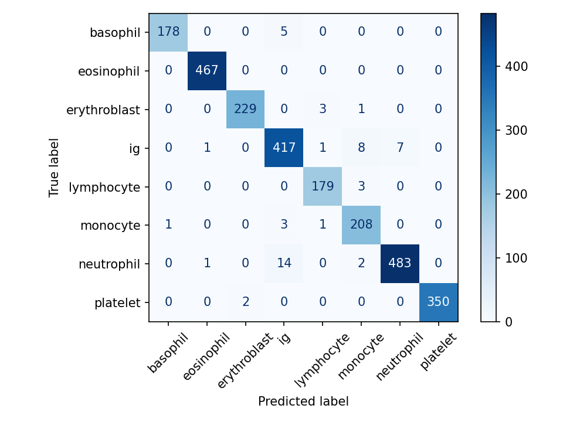
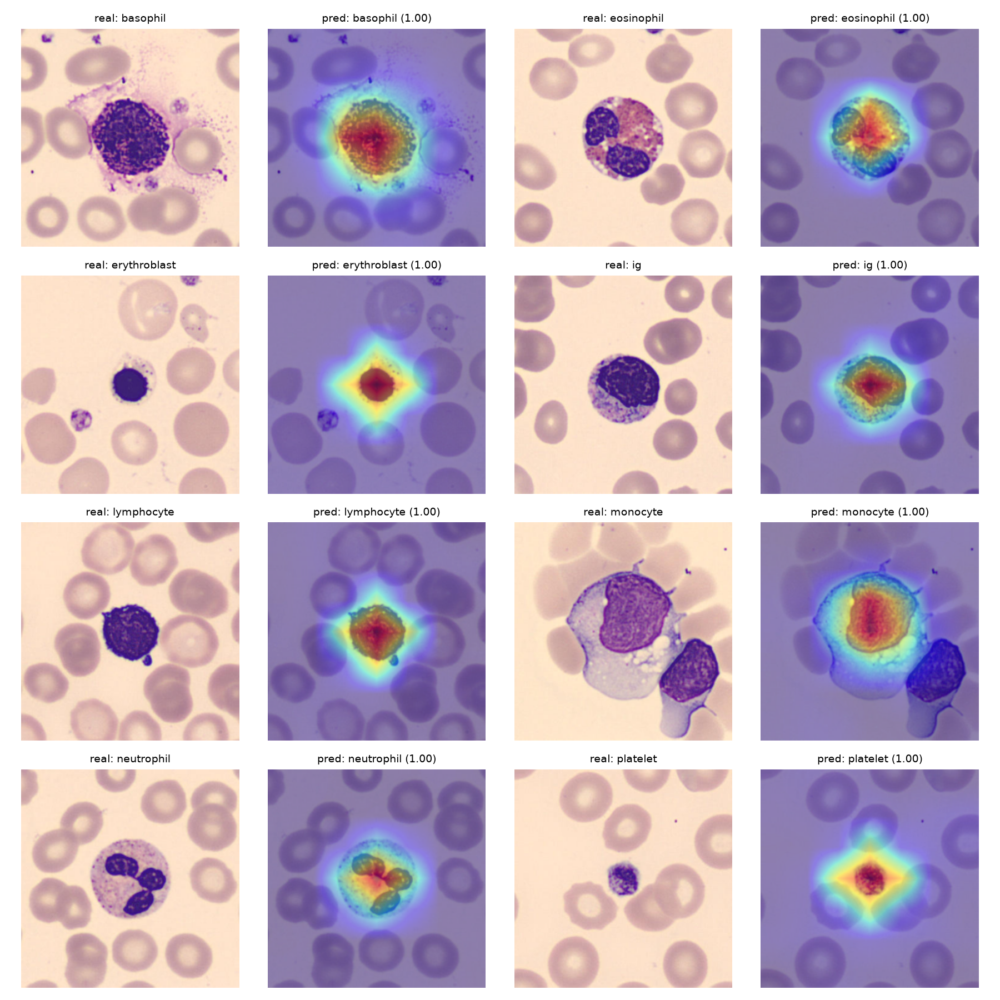

# Blood Cell Classifier

Clasificación de células sanguíneas periféricas con Deep Learning (transfer learning con EfficientNet-B0 en PyTorch).

> ⚠️ Proyecto educativo. No está validado clínicamente ni es apto para diagnóstico.

## Resumen

Clasificador de 8 tipos de células sanguíneas a partir de imágenes microscópicas.
Alcanza un **97,9 % de accuracy** en un conjunto de test que el modelo no usó para tomar decisiones (2.564 imágenes).

## Dataset

[PBC dataset](https://doi.org/10.1016/j.dib.2020.105474) (Hospital Clínic de Barcelona, Acevedo et al.): 17.092 imágenes de células individuales de personas sanas, de 360×363 px, en 8 clases:
neutrófilos, eosinófilos, basófilos, linfocitos, monocitos, granulocitos inmaduros (`ig`), eritroblastos y plaquetas.

El dataset no se incluye en el repositorio. Se descarga con `kagglehub` (ver "Cómo ejecutarlo").

## Metodología

- **Modelo:** EfficientNet-B0 preentrenado en ImageNet, con la capa final sustituida por una de 8 salidas.
- **Split:** 70 % train / 15 % validación / 15 % test, estratificado por clase.
- **Preprocesado:** redimensionado a 224×224 y normalización de ImageNet.
- **Aumento de datos (solo en train):** giros horizontales y verticales, rotación ±20°, pequeñas variaciones de brillo y contraste.
- **Entrenamiento en dos fases** (Adam):
  1. 3 épocas entrenando solo la capa final (lr = 1e-3), con el resto congelado.
  2. 10 épocas de fine-tuning, descongelando los últimos 3 bloques (lr = 1e-4).
- **Selección del modelo:** la época con mejor accuracy de validación.
- **Hardware:** GPU T4 en Google Colab.

## Resultados (test)

| Clase | Precision | Recall | F1 | Imágenes |
|---|---|---|---|---|
| basophil | 0,994 | 0,973 | 0,983 | 183 |
| eosinophil | 0,996 | 1,000 | 0,998 | 467 |
| erythroblast | 0,991 | 0,983 | 0,987 | 233 |
| ig | 0,950 | 0,961 | 0,955 | 434 |
| lymphocyte | 0,973 | 0,984 | 0,978 | 182 |
| monocyte | 0,937 | 0,977 | 0,956 | 213 |
| neutrophil | 0,986 | 0,966 | 0,976 | 500 |
| platelet | 1,000 | 0,994 | 0,997 | 352 |
| **Accuracy** | | | **0,979** | 2.564 |

La fase de fine-tuning es la que aporta la mejora: con solo la capa final entrenada, la accuracy de validación se queda en torno al 78 %; tras el fine-tuning sube al 97,7 %.

### Matriz de confusión



## Análisis de errores

De las 2.564 imágenes de test, 53 están mal clasificadas. **39 de esos 53 errores (74 %) involucran la clase `ig`**, ya sea como clase real o como predicha. Los más frecuentes son neutrófilo → `ig` (14), `ig` → monocito (8) y `ig` → neutrófilo (7).

Una posible explicación es que los granulocitos inmaduros son fases intermedias de la maduración del neutrófilo, así que la frontera entre clases es gradual. Es una hipótesis que no se ha verificado revisando las imágenes mal clasificadas.

## Interpretabilidad (Grad-CAM)



Los mapas muestran la activación más intensa sobre la célula, y las zonas de baja intensidad se extienden más allá de ella. Esto se debe en parte a la baja resolución del mapa (7×7 interpolado a 224×224). Es un análisis cualitativo sobre un conjunto pequeño de ejemplos, así que no prueba que el modelo use rasgos morfológicos concretos como la forma del núcleo.

## Limitaciones

- El dataset no incluye ID de paciente, por lo que el split no puede hacerse por paciente. Si hay varias imágenes del mismo individuo repartidas entre train y test, las métricas podrían ser optimistas.
- Todas las imágenes proceden de un único hospital y un único analizador (CellaVision DM96); no se ha evaluado con datos externos.
- Solo contiene células de personas sanas: el modelo no ve células patológicas.
- Las imágenes vienen centradas, lo que puede influir en los mapas Grad-CAM.

## Roadmap

- [ ] Detección de leucemia (B-ALL) en frotis de sangre, con un dataset distinto y un split cuidadoso por paciente.
- [ ] Comparación con una CNN entrenada desde cero como baseline.

## Estructura

```
├── notebooks/       # exploración y Grad-CAM
├── src/
│   ├── data/pbc.py  # carga de datos y split
│   ├── model.py     # EfficientNet-B0
│   └── train.py     # entrenamiento y evaluación
├── reports/         # métricas y figuras
└── requirements.txt
```

## Cómo ejecutarlo

```bash
git clone https://github.com/Julen10H/blood-cell-classifier.git
cd blood-cell-classifier
python -m venv .venv
.venv\Scripts\activate          # Linux/macOS: source .venv/bin/activate
pip install -r requirements.txt
```

Para entrenar (se recomienda GPU; en Colab es suficiente):

```bash
python -m src.train --data_dir RUTA/bloodcells_dataset --epochs_head 3 --epochs_ft 10
```

El dataset se obtiene con `kagglehub.dataset_download("unclesamulus/blood-cells-image-dataset")`.

## Cita del dataset

Acevedo A. et al., *A dataset of microscopic peripheral blood cell images for development of automatic recognition systems*, Data in Brief, 2020.
